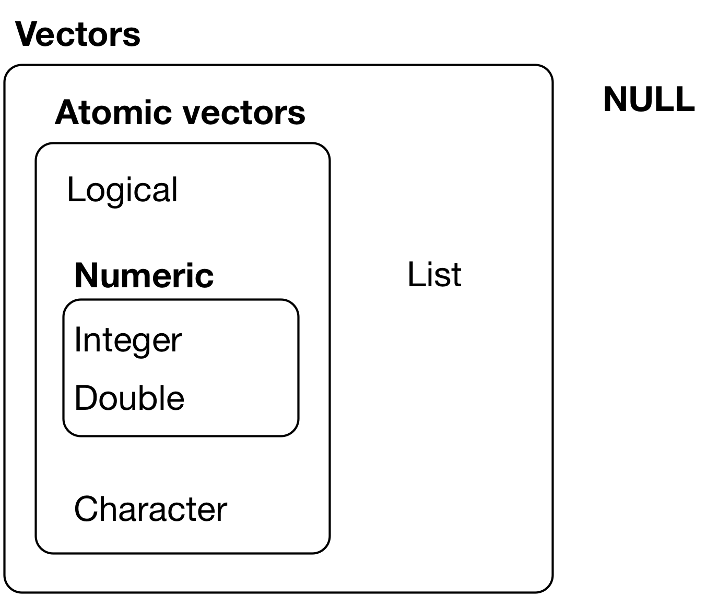

```{r, echo=FALSE, include=FALSE}
# Download images
imgs <- c('data-structures-overview.png')

for (i in imgs) {
  if(!file.exists(i)){
  download.file(url = paste0('https://raw.githubusercontent.com/anyone-can-cook/rclass1/master/lectures/intro_to_r/', i), 
                destfile = i,
                mode = 'wb')
  }
}
```

# Introduction

## Libraries we will use

**Load the packages** we will use by running this code chunk:

```{r, message=FALSE}
library(package = tidyverse)
library(package = haven)
library(package = labelled)
library(package = lubridate)
```

**If package not yet installed**, then must install before you load. Install in "console" rather than .Rmd file:

-   Generic syntax: `install.packages(pkgs = "package_name")`
-   Install "tidyverse": `install.packages(pkgs = "tidyverse")`

**Note**: When we load package, name of package is not in quotes; but when we install package, name of package is in quotes:

-   `install.packages(pkgs = "tidyverse")`
-   `library(package = tidyverse)`

## Dataset we will use

Recall from Into the tidyverse lecture, we used the data set `wwlist`. This data set represents "prospects" purchased by Western Washington U.

- Essentially, universities identify/target "prospect" by buying student lists from College Board/ACT (e.g., $.50+ per prospect).  
- Data universities purchase on students includes their contact info (e.g., address, email), academics (e.g., GPA, AP coursework), socioeconomic and demographic characteristics.  
- Universities choose which prospective students' information to purchase by filtering on criteria like their zip code, GPA, test score range, etc. 

```{r}
rm(list = ls()) # remove all objects

load(
  file = url(
    description = "https://github.com/anyone-can-cook/rclass1/raw/master/data/prospect_list/wwlist_merged.RData"
  )
)
```

# Attributes and augmented vectors

## Review data structures: Vectors

<br>

**Two types of vectors:**

1.  **Atomic vectors**
2.  **Lists**

<br>

{width="60%"}

### Atomic vectors

<br> An **atomic vector** is a collection of values

-   Each value in an atomic vector is an **element**
-   All elements within vector must have the same **data type**

```{r}
(vec_x <- c(1,2,3)) # parentheses () assign and print object in one step
length(x = vec_x) # length = number of elements
typeof(x = vec_x) # numeric atomic vector, type=double
str(object = vec_x) # investigate structure of object
```

Can assign **names** to vector elements, creating a **named atomic vector**

```{r}
(vec_x <- c(v1=1,v2=2,v3=3))
length(x = vec_x)
typeof(x = vec_x)
str(object = vec_x)
```

### Lists

<br>

-   Like atomic vectors, **lists** are objects that contain **elements**
-   However, **data type** can differ across elements within a list
    -   E.g., an element of a list can be another list

```{r}
list_x <- list(1,2,"apple")
typeof(x = list_x)
length(x = list_x)
str(object = list_x)

list_y <- list(1, c("apple", "orange"), list(1, 2))
length(x = list_y)
str(object = list_y)
```

Like atomic vectors, elements within a list can be named, thereby creating a **named list**

```{r}
# not named
str(object = list_y)

# named
list_z <- list(v1=1, v2=c("apple", "orange"), v3=list(1, 2, 3))
str(object = list_z)
```

### Data frames

<br> A **data frame** is a list with the following characteristics:

-   All the elements must be **vectors** with the same **length**
-   Data frames are **augmented lists** because they have additional **attributes**

```{r}
# a regular list
(list_x <- list(col_a = c(1,2,3), col_b = c(4,5,6), col_c = c(7,8,9)))
typeof(x = list_x)
attributes(x = list_x)
```

```{r}
# a data frame
(df_x <- data.frame(col_a = c(1,2,3), col_b = c(4,5,6), col_c = c(7,8,9)))
typeof(x = df_x)
attributes(x = df_x)
```

## Converting between types and data structures

The functions below convert an object to a different data type or data structure:

-   `as.logical()`: Convert to `logical`
-   `as.numeric()`: Convert to `numeric`
-   `as.integer()`: Convert to `integer`
-   `as.character()`: Convert to `character`
-   `as.list()`: Convert to the `list` data structure
-   `as.data.frame()`: Convert to the `data.frame` data structure

When values of different types are combined in an atomic vector, R converts them to a common type that can accommodate all the values. In the examples below, the usual progression is `logical` → `integer` → `double` → `character`.

```{r}
typeof(x = c(TRUE, 3L))
#> [1] "integer"
typeof(x = c(2L, 4.5))
#> [1] "double"
typeof(x = c(2.5, "j"))
#> [1] "character"
```

_Credit:_ [R for Data Science, section on Coercion](https://r4ds.had.co.nz/vectors.html#coercion)

<br>

**Convert to `logical` using `as.logical()`**

Character vector coerced to logical vector:

```{r}
# Only "TRUE"/"FALSE", "True"/"False", "T"/"F", "true"/"false" are able to be coerced to logical type
as.logical(x = c("TRUE", "FALSE", "True", "False", "true", "false", "T", "F", "t", "f", ""))
```

Numeric vector coerced to logical vector:

```{r}
# 0 is treated as FALSE, while all other numeric values are treated as TRUE
as.logical(x = c(0, 0.0, 1, -1, 20, 5.5))
```

<br>

**Convert to `numeric` using `as.numeric()`**

Logical vector coerced to numeric vector:

```{r}
# FALSE is mapped to 0 and TRUE is mapped to 1
as.numeric(x = c(FALSE, TRUE))
```

Character vector coerced to numeric vector:

```{r, warning = FALSE}
# Strings containing numeric values can be coerced to numeric (leading 0's are dropped) 
# All other characters become NA
as.numeric(x = c("0", "007", "2.5","2.6", "abc", "."))
```

<br>

**Convert to `integer` using `as.integer()`**

Logical vector coerced to integer vector:

```{r}
# FALSE is mapped to 0 and TRUE is mapped to 1
as.integer(x = c(FALSE, TRUE))
```

Character vector coerced to integer vector:

```{r, warning = FALSE}
# Strings containing numeric values can be coerced to integer
# Leading 0's are dropped; decimals are truncated, not rounded
# All other characters become NA
as.integer(x = c("0", "007", "2.5","2.6", "abc", "."))
```

Numeric vector coerced to integer vector:

```{r, warning = FALSE}
# All decimal places are truncated
as.integer(x = c(0, 2.1, 10.5, 8.8, -1.8))
```

<br>

**Convert to `character` using `as.character()`**

Logical vector coerced to character vector:

```{r}
as.character(x = c(FALSE, TRUE))
```

Numeric vector coerced to character vector:

```{r, warning = FALSE}
as.character(x = c(-5, 0, 2.5))
```

Integer vector coerced to character vector:

```{r, warning = FALSE}
as.character(x = c(-2L, 0L, 10L))
```

<br>

**Convert to `list` using `as.list()`**

Atomic vectors coerced to list:

```{r}
# Logical vector
as.list(x = c(TRUE, FALSE))

# Character vector
as.list(x = c("a", "b", "c"))

# Numeric vector
as.list(x = 1:3)
```

<br>

**Convert to `data.frame` using `as.data.frame()`**

Lists coerced to dataframe:

```{r}
# Create a list
list_x <- list(A = c("x", "y", "z"), B = c(1, 2, 3))
str(object = list_x)

# Convert to class `data.frame`
df_x <- as.data.frame(x = list_x, stringsAsFactors = F)
str(object = df_x)
```

Notice that the underlying type is still a list, but the object now has additional attributes that identify it as a data frame.

<details>

<summary>**Example**: Practical example of converting type</summary>

When working with data, it may be helpful to label values for certain variables. Data files often come with a code book that defines how values are coded. Let's look at an example of labeling values and how converting data type may come into play.

We'll look at the `FIPS` variable from the [Integrated Postsecondary Education Data System (IPEDS)](https://nces.ed.gov/ipeds/use-the-data) data. The [state FIPS code](https://en.wikipedia.org/wiki/Federal_Information_Processing_Standard_state_code#FIPS_state_codes) is a numeric code that identifies a state. For example, `1` is the FIPS code for `Alabama`, `2` is the FIPS code for `Alaska`, etc. We'll want to label each numeric value in the `FIPS` column with the corresponding state name.

```{r}
# Library for labeling variables and values in a dataframe
library(package = labelled)

# Read in IPEDS data and codebook
ipeds_df <- read.csv(
  file = 'https://raw.githubusercontent.com/cyouh95/recruiting-chapter/master/data/ipeds_hd2017.csv',
  header = TRUE,
  na.strings = c('', 'NA'),
  stringsAsFactors = F
)
ipeds_values <- read.csv(
  file = 'https://raw.githubusercontent.com/cyouh95/recruiting-chapter/master/data/ipeds_hd2017_values.csv',
  header = TRUE,
  na.strings = c('', 'NA'),
  stringsAsFactors = F
)

# The codebook defines how variables are coded, such as STABBR, FIPS, and other variables
head(x = ipeds_values)

# Filter codebook for just the values for the FIPS variable
fips_values <- ipeds_values %>% filter(varname == 'FIPS') %>% select(varname, codevalue, valuelabel)
head(x = fips_values)
```

<br> When we read in the data from the CSV files, R automatically tries to determine the data type of each variable. As seen below, the `FIPS` column from the `ipeds_df` that we want to label is of type `integer`, while the `codevalue` column from the codebook is of type `character` (since not all values are numeric):

```{r}
# Type of `FIPS` column
str(object = ipeds_df$FIPS)

# Type of `codevalue` column
str(object = fips_values$codevalue)
```

<br> This discrepancy becomes a problem when we try to label the value using the `labelled` library:

```{r, eval=FALSE}
# Error: `x` and `labels` must be same type
val_label(ipeds_df$FIPS, fips_values[1, 'codevalue']) <- fips_values[1, 'valuelabel']
```

<br> To resolve this, we can use `as.integer()` to convert the `codevalue` from `character` type to `integer` before trying to label the value:

```{r}
# This now works
val_label(ipeds_df$FIPS, as.integer(x = fips_values[1, 'codevalue'])) <- fips_values[1, 'valuelabel']

# Check value labels
val_labels(x = ipeds_df$FIPS)

# We can use as.integer() to convert the entire vector (ie. codevalue column) to integer
fips_values$codevalue <- as.integer(x = fips_values$codevalue)

# Type of `codevalue` column
str(object = fips_values$codevalue)

# Use loop to label the rest of the values
for (i in 1:nrow(x = fips_values)) {
  val_label(ipeds_df$FIPS, fips_values[i, 'codevalue']) <- fips_values[i, 'valuelabel']
}

# Check value labels
val_labels(x = ipeds_df$FIPS)
```

</details>


## Atomic vectors, augmented vectors, and augmented lists

**Atomic vectors** \[our focus so far\]

-   I think of atomic vectors as "just the data"
-   Atomic vectors are the building blocks for augmented vectors

<br>

**Augmented atomic vectors**

-   **Augmented atomic vectors** are atomic vectors with additional **attributes** attached
    -   Factors and dates are examples we will encounter later in this lecture

**Augmented lists**

-   **Augmented lists** are lists with additional **attributes** attached
    -   A data frame is a common example of an augmented list

**Attributes**

-   **Attributes** are additional "metadata" that can be attached to any object (e.g., vector or list)
-   **Metadata** is information that describes the data. For example, a variable’s name, category labels, or how R should treat it.

Example: Variables of a dataset

-   A data frame is a list
-   Each element in the list is a variable, which consists of:
    -   Atomic vector ("just the data")
    -   Any attributes we want to attach to each element/variable
-   Variable **name**, an attribute of the data frame object

Other examples of attributes in R

-   Value **labels**: Character labels (e.g., "Charter School") attached to numeric values
-   Object **class**: Specifies how object should be treated by object oriented programming language

**Main takeaway**:

-   Attributes add metadata to R objects
-   An augmented atomic vector or augmented list combines the underlying data structure with additional attributes

## Attributes and functions to identify/modify attributes

Description of attributes from Grolemund and Wickham 20.6

-   "Any vector can contain arbitrary additional **metadata** through its **attributes**"
-   "You can think of **attributes** as named list of vectors that can be attached to any object"

Functions to identify and modify attributes

-   `attributes()`: gets or sets all attributes of an object
-   `attr()`: gets or sets one attribute of an object

### Describe all attributes of an object

```{r, eval=FALSE}
# pull up help file for the attributes() function
?attributes
```

Attributes of a **named atomic vector**:

```{r}
# create named atomic vector
(vec_x <- c(a = 1, b = 2, c = 3, d = 4))
attributes(x = vec_x)

attributes(x = vec_x) %>% str() # a named list of vectors!

# remove all attributes from the object
attributes(vec_x) <- NULL
vec_x
attributes(x = vec_x)
```

In this example, removing all attributes only removes the vector's names. Be careful when using this syntax with other objects: it can remove important information such as an object's class or factor levels.

### Attributes of a variable in a data frame

<br>

**Accessing variable using `[[]]` subset operator**

-   Recall `object_name[["element_name"]]` accesses contents of the element
-   If object is a data frame, `df_name[["var_name"]]` accesses contents of variable
    -   For simple vars like `firstgen`, syntax yields an atomic vector ("just the data")
-   Shorthand syntax for `df_name[["var_name"]]` is `df_name$var_name`

```{r}
str(object = wwlist[["firstgen"]])
attributes(x = wwlist[["firstgen"]])

str(object = wwlist$firstgen) # same same
attributes(x = wwlist$firstgen)
```

**Accessing variable using `[]` subset operator**

-   `object_name["element_name"]` creates object of same type as `object_name`
-   If object is a data frame, `df_name["var_name"]` returns a data frame containing just the `var_name` column

```{r, results="hide"}
str(object = wwlist["firstgen"])
attributes(x = wwlist["firstgen"])
```

### Attributes of lists and data frames

<br>

Attributes of a **named list**:

```{r}
list_x <- list(col_a = c(1,2,3), col_b = c(4,5,6))
str(object = list_x)
attributes(x = list_x)
```

Note that the `names` attribute is an attribute of the list, not an attribute of the elements within the list (which are atomic vectors)

```{r}
list_x[['col_a']] # the element named 'col_a'
str(object = list_x[['col_a']]) # structure of the element named 'col_a'
attributes(x = list_x[['col_a']]) # attributes of element named 'col_a'
```

Attributes of a **data frame**:

```{r}
df_x <- data.frame(col_a = c(1,2,3), col_b = c(4,5,6))
str(object = df_x)
attributes(x = df_x)
```

Note: attributes `names`, `class` and `row.names` are attributes of the data frame

-   they are not attributes of the elements (variables) within the data frame, which are atomic vectors (i.e., just the data)

```{r}
str(object = df_x[['col_a']]) # structure of the element named 'col_a'
attributes(x = df_x[['col_a']]) # attributes of element named 'col_a'
```

### attr() function to get or set specific attributes of an object

```{r, eval=FALSE, include=FALSE}
?attr
```

Syntax

-   Get: `attr(x = obj_name, which = attribute_name, exact = FALSE)`
-   Set: `attr(obj_name, attribute_name) <- value`

Arguments

-   `x`: an object whose attributes are to be accessed
-   `which`: a non-empty character string specifying which attribute is to be accessed
-   `exact` (logical): should `which` be matched exactly? default is `exact = FALSE`
-   `value`: an object, new value of attribute, or `NULL` to remove attribute

<br>

**Using `attr()` to get specific attribute of an object**

```{r}
vec_x <- c(a = 1, b= 2, c= 3, d = 4)
attributes(x = vec_x)
attr(x = vec_x, which = "names", exact = FALSE)
attr(x = vec_x, which = "names")
attr(x = vec_x, which = "name") # we don't provide exact name of attribute
attr(x = vec_x, which = "name", exact = TRUE) # don't provide exact name of attribute
```

<br>

**Using `attr()` to set specific attribute of an object**

```{r, results = "hide"}
(vec_x <- c(a = 1, b= 2, c= 3, d = 4))
attributes(x = vec_x) # see all attributes

attr(x = vec_x, which = "greeting") <- "Hi!" # create new attribute
attr(x = vec_x, which = "greeting") # see attribute

attr(vec_x, "farewell") <- "Bye!" # create attribute

attributes(x = vec_x) # see all attributes

# remember that the attribute object is just a named list of vectors
attributes(x = vec_x) %>% str() # each attribute is an element of a list; 
  # for each attribute, we have an attribute name and an atomic vector that contains the values of that attribute

attr(x = vec_x, which = "names") # see names attribute
attr(x = vec_x, which = "names") <- NULL # delete names attribute

attributes(x = vec_x) # see all attributes
```
<br>

### attr() function on data frames

<br>

**Using `wwlist`, create data frame with three variables**

```{r}
wwlist_small <- wwlist[1:25, ] %>% select(hs_state,firstgen,med_inc_zip)
str(object = wwlist_small)
attributes(x = wwlist_small)
attributes(x = wwlist_small) %>% str()
```
<br>

**Get/set attribute of a data frame**

```{r}
#get/examine names attribute
attr(x = wwlist_small, which = "names")
str(object = attr(x = wwlist_small, which = "names")) # names attribute is character atomic vector, length=3
#add new attribute to data frame
attr(x = wwlist_small, which = "new_attribute") <- "contents of new attribute"
attributes(x = wwlist_small)
```

**Get/set attribute of a variable in data frame** (output omitted)

```{r, results = "hide"}
str(object = wwlist_small$med_inc_zip)
attributes(x = wwlist_small$med_inc_zip)
#create attribute for variable med_inc_zip
attr(wwlist_small$med_inc_zip, "inc attribute") <- "inc attribute contents"
#investigate attribute for variable med_inc_zip
attributes(x = wwlist_small$med_inc_zip)
str(object = wwlist_small$med_inc_zip)
attr(x = wwlist_small$med_inc_zip, which = "inc attribute")
```

### Why add attributes to data frame or variables of data frame?

Pedagogical reasons

-   Important to know how you can apply `attributes()` and `attr()` to data frames and to variables within data frames

<br>

**Practical application: changing variable names from lower-case to upper-case or vice versa**

There are other ways to change variable names, but here is one.

```{r, results = "hide"}
# first we investigate
  attributes(x = wwlist_small)
  
  #let's take a gander at the names attribute
  attr(x = wwlist_small, which = "names")
  attr(x = wwlist_small, which = "names") %>% str() # a character atomic vector of length 3
  
  wwlist_small %>% length() # not coincidentally, the object wwlist_small also has length = 3
  
# without assignment, let's see if we can apply str_to_upper() function to names attribute
  attr(x = wwlist_small, which = "names")
  
  attr(x = wwlist_small, which = "names") %>% str_to_upper()
  
# now, let's change variable names to uppercase [PLEASE NEVER DO THIS!]
  attr(x = wwlist_small, which = "names") <- attr(x = wwlist_small, which = "names") %>% str_to_upper()
  
  attributes(wwlist_small)
  wwlist_small %>% print(n=3)
  
# now, let sanity previal and change the names back to lowercase!
  
  attr(x = wwlist_small, which = "names") # always inspect before we modify!
  
  attr(x = wwlist_small, which = "names") <- attr(x = wwlist_small, which = "names") %>% str_to_lower()
  
  attributes(wwlist_small) # thank goodness!
  wwlist_small %>% print(n=3)
  
```

<br>

**Practical application: in interactive dashboards**

-   When creating "dashboard" you might want to add "tooltips"
    -   "Tooltip" is a message that appears when cursor is positioned over an icon
    -   The text in the tooltip is the contents of an attribute
-   Example dashboard: [LINK](https://jkcf.shinyapps.io/dashboard/)

### Student exercise

1.  Using `wwlist`, create data frame of 30 observations with three variables: `state`, `zip5`, `pop_total_zip`

2.  Return all attributes of this new data frame using `attributes()`. Then, get the `names` attribute of the data frame using `attr()`.

3.  Add a new attribute to the data frame called `attribute_data` whose content is `"new attribute of data"`. Then, return all attributes of the data frame as well as get the value of the newly created `attribute_data`.

4.  Return the attributes of the variable `pop_total_zip` in the data frame.

5.  Add a new attribute to the variable `pop_total_zip` called `attribute_variable` whose content is `"new attribute of variable"`. Then, return all attributes of the variable as well as get the value of the newly created `attribute_variable`.

<details>

<summary><strong>Solutions to student exercise</strong></summary>

```{r, results = "hide"}
# Part 1
wwlist_exercise <- wwlist[1:30, ] %>% select(state, zip5, pop_total_zip)

# Part 2
attributes(x = wwlist_exercise)
attr(x = wwlist_exercise, which = "names")

# Part 3
attr(x = wwlist_exercise, which = "attribute_data") <- "new attribute of data"

attributes(x = wwlist_exercise)
attr(x = wwlist_exercise, which = "attribute_data")

# Part 4
attributes(x = wwlist_exercise$pop_total_zip)

# Part 5
attr(wwlist_exercise$pop_total_zip, "attribute_variable") <- "new attribute of variable"

attributes(x = wwlist_exercise$pop_total_zip)
attr(x = wwlist_exercise$pop_total_zip, which = "attribute_variable")
```

</details>

<br>

# Object class

<br>

Every object in R has a **class**. An object's **type** describes how its values are stored, while its **class** helps R interpret the object and determine how functions behave when applied to it.

-   Common classes include `numeric`, `character`, `factor`, `Date`, and `data.frame`
-   An object's class helps determine:
    -   Which functions are appropriate for that object
    -   How functions interpret, display, or transform the object
-   **Type** and **class** are related, but they are not the same:
    -   **Type** describes how an object's values are stored
    -   **Class** helps describe what the object represents and how R should treat it
-   For many objects, class is stored in a `class` attribute
    -   For simple atomic vectors, R can infer the class from the object's type even when there is no explicit `class` attribute
-   An object can also have more than one class

Use the `class()` function to identify an object's class:

```{r}
(vec_x <- c(a = 1, b= 2, c= 3, d = 4))
typeof(x = vec_x)
class(x = vec_x)
```

When I encounter a new object I often investigate object by applying `typeof()`, `class()`, and `attributes()` functions:

```{r}
typeof(x = vec_x)
class(x = vec_x)
attributes(x = vec_x)
```

## Why is object class important?

<br>

When you apply a function to an object, the object's **type** and **class** can both matter.

-   Different functions use type and class in different ways:
    -   Date functions often rely on **class** to interpret stored values as dates
    -   String functions operate on objects with **character type**; when an object's type is not character, its **class** can affect how it is converted to character
    -   Mathematical functions generally require a numeric or logical **type**, but an object's **class** can change or prevent the calculation
-   Some functions can work with more than one class but behave differently depending on the object's class
-   Some functions try to convert an object to an appropriate type or class before operating on it

Therefore, an object's class can affect:

-   Whether a function can work with the object
-   How the function interprets the object
-   What kind of result the function returns

### Class and object-oriented programming

<br>

R is an **object-oriented programming language**.

In plain language, this means that functions can use the class of the object they receive to decide how to behave. The same function may do one thing when applied to an object of one class and something different when applied to an object of another class.

You do not need to learn how to create an object-oriented system for this course. The practical idea is:

-   Objects have classes
-   Functions can use those classes
-   The same function can behave differently for different classes

Some R functions are **generic functions**. A generic function examines an object's class and selects a class-specific version of the function to use.

Examples of generic functions include:

-   `print()`, which displays an object
-   `summary()`, which produces a summary of an object

The class-specific version of a generic function is called a **method**. Method names often combine the generic function's name and the class name.

For example, when you call `print()` on an object with class `Date`:

1.  You call the generic function `print()`
2.  R examines the object's class and sees that it is `Date`
3.  R executes the `print.Date()` method, which displays the stored values as calendar dates

When you call `print()` on an object with class `data.frame`, R instead executes the `print.data.frame()` method, which displays the object in rows and columns.

The same process occurs when you call `summary()`:

-   For an object with class `factor`, R executes `summary.factor()`, which reports the number of observations in each factor level
-   For an object with class `data.frame`, R executes `summary.data.frame()`, which produces an appropriate summary for each variable

You normally call the generic function, such as `print()` or `summary()`. R examines the object's class and executes the appropriate method for you.

Many object classes already exist in R, and packages can provide additional classes.

-   Examples include `numeric`, `character`, `factor`, `Date`, and `data.frame`
-   The `haven` package provides classes for variables imported with value labels
-   In this course, we will work with classes that have already been created for us

### Implicit versus explicit class

<br>

An object's class can be **implicit** or **explicit**:

-   An **implicit class** is inferred by R from the object's underlying type
    -   Examples include ordinary numeric, integer, logical, and character atomic vectors
-   An **explicit class** is stored in the object's `class` attribute
    -   Examples include objects with class `Date`, `factor`, and `data.frame`

To see the difference, let's compare two atomic vectors that contain the same underlying values and have the same underlying type.

```{r}
# Create an ordinary numeric vector
vec_num <- c(19723, 19724, 19725)

# Create a Date vector using ymd() from lubridate
vec_date <- ymd(
  c("2024-01-01", "2024-01-02", "2024-01-03")
)

vec_num
vec_date
```

Both objects have type `double`:

```{r}
typeof(x = vec_num)
typeof(x = vec_date)
```

However, the objects have different classes:

```{r}
class(x = vec_num)
class(x = vec_date)
```

Now inspect whether each object has a stored `class` attribute:

```{r}
attr(x = vec_num, which = "class")
attr(x = vec_date, which = "class")

attributes(x = vec_num)
attributes(x = vec_date)
```

-   `vec_num` has an implicit `numeric` class. R infers this class from the vector's `double` type, even though the object does not have a stored `class` attribute.
-   `vec_date` has an explicit `Date` class stored in its `class` attribute. This attribute tells R to interpret and display the underlying numbers as dates.

**Main takeaway**: good practice to use `class()` to identify an object's class. 

- using `attr()` or `attributes()` function to identify class attribute will miss the implicit classes of simple atomic vectors.

### Functions can depend on object type, class, or both

The examples below show that different functions use type and class in different ways.

**Example: `sum()`—underlying type matters**

The `sum()` function is designed to operate on logical, integer, double, or complex data.

Apply `sum()` to a logical vector:

```{r}
vec_logical <- c(TRUE, FALSE, NA, TRUE)

typeof(x = vec_logical)
class(x = vec_logical)

sum(vec_logical, na.rm = TRUE)
```

For mathematical calculations, R treats `TRUE` as `1` and `FALSE` as `0`. Therefore, this sum counts the two `TRUE` values.

A character vector cannot be summed because its underlying type is not appropriate for mathematical calculation.

```{r, eval=FALSE}
vec_character <- c("1", "2", "3")

typeof(x = vec_character)
class(x = vec_character)

sum(vec_character)
```

**Class can change function behavior even when the underlying type is the same**

Apply `sum()` to the ordinary numeric vector created in the previous section:

```{r}
typeof(x = vec_num)
class(x = vec_num)

sum(vec_num)
```

Now try to apply `sum()` to the Date vector:

```{r, eval=FALSE}
typeof(x = vec_date)
class(x = vec_date)

sum(vec_date) # won't run because not an appropriate class 
```

`vec_num` and `vec_date` have the same underlying values and the same `double` type. However, `vec_date` has an explicit `Date` class, and adding calendar dates together is not a meaningful operation. Its class therefore prevents `sum()` from performing the calculation.

**Example: `year()`—class supplies meaning**

The `year()` function from `lubridate` is designed to extract the year from an object with a date or date-time class.

```{r}
typeof(x = vec_date)
class(x = vec_date)

year(x = vec_date)
```

Although `vec_date` is stored as double values, its `Date` class tells `year()` to interpret those values as calendar dates.

**Example: `tolower()`—a function can convert its input**

The `tolower()` function operates on character data:

```{r}
vec_character <- c("SEATTLE", "BELLINGHAM")

typeof(x = vec_character)
class(x = vec_character)

tolower(x = vec_character)
```

`tolower()` can also accept some non-character objects by converting them to character first. An object's class can affect how that conversion occurs.

**Main takeaway**:

-   A function may rely primarily on an object's type
-   A function may rely primarily on an object's class
-   A function may use both type and class
-   A function may convert an object before operating on it


# Class == factor

**Recoding variable `ethn_code` from data frame `wwlist`**

Let's first recode the `ethn_code` variable:

As introduced in the mutate lecture, `recode_values()` maps each existing value on the left-hand side of `~` to its new value on the right-hand side.

```{r, results= "hide"}
wwlist <- wwlist %>%  
  mutate(ethn_code = 
    recode_values(x = ethn_code,
      "american indian or alaska native" ~ "nativeam",
      "asian or native hawaiian or other pacific islander" ~ "api",
      "black or african american" ~ "black",
      "cuban" ~ "latinx",
      "mexican/mexican american" ~ "latinx",
      "not reported" ~ "not_reported",
      "other-2 or more" ~ "multirace",
      "other spanish/hispanic" ~ "latinx",
      "puerto rican" ~ "latinx",
      "white" ~ "white",
      default = ethn_code
    )
  )

str(object = wwlist$ethn_code)
wwlist %>% count(ethn_code)
```

## Factors

**Factors** are an object *class* used to represent categorical data (e.g., marital status)

-   A factor is an **augmented atomic vector** built from an integer vector with two important attributes:
    -   A `levels` attribute that associates the underlying integers with category labels
    -   An explicit `class = "factor"` attribute that tells R to treat the object as a factor

Categorical variables can be stored as character or factor variables:

-   Character variables are often convenient while cleaning and recoding data
-   Factor variables are especially useful when category order, display order, reference categories, or modeling behavior matters
-   So far in the course I have made all categorical variables character variables because we have not introduced factors yet

**Create factor version of character variable `ethn_code` using base R `factor()` function**:

```{r}
str(object = wwlist$ethn_code)
class(x = wwlist$ethn_code)

# create factor variable using factor() within mutate()
wwlist <- wwlist %>% mutate(ethn_code_fac = factor(x = ethn_code))
#wwlist$ethn_code_fac <- factor(x = wwlist$ethn_code) # base r approach

str(object = wwlist$ethn_code)
str(object = wwlist$ethn_code_fac)
```

**Character variable `ethn_code`**:

```{r}
typeof(x = wwlist$ethn_code)
class(x = wwlist$ethn_code)
attributes(x = wwlist$ethn_code)
str(object = wwlist$ethn_code)
```

**Factor variable `ethn_code_fac`**:

```{r}
typeof(x = wwlist$ethn_code_fac)
class(x = wwlist$ethn_code_fac)
attributes(x = wwlist$ethn_code_fac)
str(object = wwlist$ethn_code_fac)
```

## Working with factor variables

Main things to note about variable `ethn_code_fac`

-   **type** = integer
-   **class** = factor, stored in the explicit `class` attribute
-   The underlying data are integers, while the **levels** attribute supplies the category labels that are displayed:

```{r}
# Print first few obs of ethn_code_fac
wwlist$ethn_code_fac[1:5]

# Print count for each category in ethn_code_fac
wwlist %>% count(ethn_code_fac)
```

Apply `as.integer()` to display the underlying integer codes of the factor variable

-   This is useful for understanding how factors are stored internally
-   Do not use these integer codes to identify categories in an analysis because the codes can change if the factor levels change or are reordered

```{r, eval=FALSE, include=FALSE}
?as.integer
```

Investigate `as.integer()` function:

```{r}
typeof(x = wwlist$ethn_code_fac)
class(x = wwlist$ethn_code_fac)

typeof(x = as.integer(x = wwlist$ethn_code_fac))
class(x = as.integer(x = wwlist$ethn_code_fac))
```

Display underlying integer values of variable `ethn_code_fac`:

```{r}
wwlist %>% count(as.integer(x = ethn_code_fac))
```

<br>

Refer to categories of a factor (e.g., when filtering observations) using values of the **levels** attribute rather than the underlying integer codes

-   Values of **levels** attribute for `ethn_code_fac` (output omitted)

```{r, results='hide'}
attributes(x = wwlist$ethn_code_fac)
```

<br>

**Example**: Count the number of prospects in `wwlist` who identify as "white"

```{r}
# referring to an underlying integer code; this doesn't work
wwlist %>% filter(ethn_code_fac==7) %>% count() 

# referring to a value of the levels attribute; this works
wwlist %>% filter(ethn_code_fac=="white") %>% count()
```

Although applying `as.integer()` first would make the code below run, do not use this approach to identify categories. The code `7` describes the current position of `"white"` in the levels, and that position can change.

```{r, eval=FALSE}
# not recommended: relies on the current ordering of the factor levels
attributes(x = wwlist$ethn_code_fac)
wwlist %>% filter(as.integer(x = ethn_code_fac)==7) %>% count()
```

## How to identify the variable values associated with factor levels

Create a factor version of the character variable `psat_range`

```{r, results="hide", warning = FALSE}
wwlist %>% count(psat_range)
wwlist <- wwlist %>% mutate(psat_range_fac = factor(x = psat_range))
wwlist %>% count(psat_range_fac)
attributes(x = wwlist$psat_range_fac)
```

Investigate values associated with factor levels using `levels()` and `nlevels()`

```{r, results="hide"}
levels(x = wwlist$psat_range_fac) #starts at 1
nlevels(x = wwlist$psat_range_fac) #7 levels total
levels(x = wwlist$psat_range_fac)[1:3] #prints levels 1-3
```

Once values associated with factor levels are known, filter using the level label rather than its underlying integer code:

```{r}
wwlist %>% filter(psat_range_fac=="1270-1520") %>% count()
```


### Student exercise working with factors

1.  After running the code below, use `typeof()`, `class()`, `str()`, and `attributes()` functions to check the new variable `receive_year`\
2.  Create a factor variable from the input variable `receive_year` and name it `receive_year_fac`\
3.  Run the same functions (`typeof()`, `class()`, etc.) from the first question using the new variable you created\
4.  Get a count of `receive_year_fac`. (**hint:** you could also run this in the console to see values associated with each factor)

Run this code to create a year variable from the input variable `receive_date`:

```{r, results="hide", message=FALSE}
# wwlist %>% glimpse()

library(package = lubridate) # load library if you haven't already
wwlist <- wwlist %>%
  mutate(receive_year = year(x = receive_date)) # create year variable with lubridate

# Check variable
wwlist %>% 
  count(receive_year)

wwlist %>%
  group_by(receive_year) %>% 
  count(receive_date)

```

<details>

<summary><strong>Solutions to student exercise working with factors `%>%`</strong></summary>

1.  After running the code below, use `typeof()`, `class()`, `str()`, and `attributes()` functions to check the new variable `receive_year`

```{r}
typeof(x = wwlist$receive_year)
class(x = wwlist$receive_year)
str(object = wwlist$receive_year)
attributes(x = wwlist$receive_year)
```

2.  Create a factor variable from the input variable `receive_year` and name it `receive_year_fac`\

```{r}
# create factor var; tidyverse approach
wwlist <- wwlist %>%
  mutate(receive_year_fac = factor(x = receive_year))

```

3.  Run the same functions (`typeof()`, `class()`, etc.) from the first question using the new variable you created\

```{r}
typeof(x = wwlist$receive_year_fac)
class(x = wwlist$receive_year_fac)
str(object = wwlist$receive_year_fac)
attributes(x = wwlist$receive_year_fac)
```

4.  Get a count of `receive_year_fac`. (**hint:** you could also run this in the console to see values associated with each factor)

```{r}
wwlist %>%
  count(receive_year_fac)
```

</details>

<br>

# Haven-labelled vectors

## Data we will use to introduce haven-labelled vectors

High school longitudinal surveys from National Center for Education Statistics (NCES)

-   Follow U.S. students from high school through college, labor market

<br>

We will be working with [High School Longitudinal Study of 2009 (HSLS:09)](https://nces.ed.gov/surveys/hsls09/index.asp)

-   Follows 9th graders from 2009
-   Data collection waves
    -   Base Year (2009)
    -   First Follow-up (2012)
    -   2013 Update (2013)
    -   High School Transcripts (2013-2014)
    -   Second Follow-up (2016)
    
HSLS is one of the data sources we used for article, [A Sociological Analysis of Structural Racism in 'Student List' Lead Generation Products](https://journals.sagepub.com/doi/full/10.3102/01623737231210894)

## Using `haven` package to read SAS/SPSS/Stata datasets into R

[`haven`](https://haven.tidyverse.org/), which is part of **tidyverse**, "enables R to read and write various data formats" from the following statistical packages:

-   SAS
-   SPSS
-   Stata

<br>

If you haven't installed `haven` run the following code in your console.

-   Generic syntax: `install.packages(pkgs = "package_name")`
-   Install "haven": `install.packages(pkgs = "haven")`

Make sure to load `haven` (e.g., `library(package = haven)`)

When using `haven` to read data, resulting R objects have these characteristics:

-   Data frames are **tibbles**, Tidyverse's preferred **class** of data frames
-   Variables with "value labels" are imported as **haven-labelled vectors**
    -   `class()` generally returns a class vector beginning with `"haven_labelled"`, followed by other classes that describe the object
    -   This is an example of one object having more than one class
    -   Haven-labelled vectors preserve the original values and metadata imported from another statistical package
    -   Helpful description of haven-labelled vectors [HERE](https://haven.tidyverse.org/articles/semantics.html)
-   Dates and times converted to R date/time classes
-   Character vectors not converted to factors

Use `read_dta()` function from `haven` package to import Stata dataset into R

```{r, results="hide"}
hsls <- read_dta(file = "https://github.com/ozanj/rclass/raw/master/data/hsls/hsls_stu_small.dta")
```

**Must** run this code chunk; changes the variable names in the in-memory `hsls` object from uppercase to lowercase

-   This does not permanently change the variable names in the source Stata file

```{r, results="hide"}
names(x = hsls)
names(hsls) <- tolower(x = names(x = hsls)) # convert names to lowercase
names(x = hsls) # names now lowercase

str(object = hsls) # ugh
```

**Investigate variable `s3classes` from data frame `hsls`**

-   Identifies whether respondent taking postsecondary classes as of 11/1/2013

```{r, results="hide"}
typeof(x = hsls$s3classes)
class(x = hsls$s3classes)
str(object = hsls$s3classes)
```

**Investigate attributes of `s3classes`**

```{r, results="hide"}
attributes(x = hsls$s3classes) # all attributes

#specific attributes: using syntax: attr(x = obj_name, which = attribute_name, exact = FALSE)
attr(x = hsls$s3classes, which = "label") # label attribute
attr(x = hsls$s3classes, which = "labels") # labels attribute
```

## What is a haven-labelled vector?

<br>

**Variable labels** are descriptions attached to a specific variable (e.g., "marital status").

**Value labels** are descriptions attached to specific stored values of a variable, e.g.:

-   Var value `1` attached to value label "married", `2`="single", `3`="divorced"

<br>

Haven-labelled vectors preserve variables with **value labels** imported from SAS, SPSS, or Stata.

-   The `haven` package provides the `haven_labelled` class
-   A haven-labelled vector can have underlying type integer, double, or character
-   The object can have multiple classes, so `class()` may return more than one value
-   To see `value labels` associated with each value:
    -   `attr(x = df_name$var_name, which = "labels")`
    -   E.g., `attr(x = hsls$s3classes, which = "labels")`

Investigate the attributes of `hsls$s3classes`

```{r, results="hide"}
typeof(x = hsls$s3classes)
class(x = hsls$s3classes)
str(object = hsls$s3classes)
attributes(x = hsls$s3classes)
```

Use `attr(x = obj_name, which = "attribute_name")` to refer to each attribute

```{r, results="hide"}
attr(x = hsls$s3classes, which = "label")
attr(x = hsls$s3classes, which = "format.stata")
attr(x = hsls$s3classes, which = "class")
attr(x = hsls$s3classes, which = "labels")
```

## `labelled` package

Purpose of the `labelled` package is to work with data imported from SPSS, Stata, or SAS using the `haven` package

-   `labelled` contains functions for working with variable labels, value labels, and defined missing values stored as metadata
-   More info on the `labelled` package: [LINK](https://larmarange.github.io/labelled/articles/labelled.html)

Functions in `labelled` package

-   [Full list](https://larmarange.github.io/labelled/reference/index.html)

```{r, eval=FALSE, include=FALSE}
?labelled
```

## Get variable and value labels

**Get variable labels** using `var_label()`

```{r}
hsls %>% select(s3classes) %>% var_label()
```

<br>

**Get value labels** using `val_labels()`

```{r}
hsls %>% select(s3classes) %>% val_labels()
```

## Working with haven-labelled data

<br>

Create frequency tables with haven-labelled variables using `count()`

-   Current tibble output shows the stored variable **values** together with their **value labels**

```{r}
hsls %>% count(s3classes)
```

<br>

To use the value labels themselves as the displayed category values, add `%>% as_factor()` to the pipe

-   `as_factor()` is a function from `haven` that converts a haven-labelled object to a factor
-   Earlier, we used base R `factor()` for ordinary character or numeric vectors. Here, we use `haven::as_factor()` because the starting variable is haven-labelled; its value labels become the factor levels.

```{r}
hsls %>% count(s3classes) %>% as_factor()
```

To isolate values of haven-labelled variables in `filter()`:

-   Refer to variable **value**, not the **value label**

**Important note about missing-value codes**:

-   A label such as `"Unit non-response"` or `"Missing"` does not automatically make the stored value missing in R
-   Values such as `-8` and `-9` remain ordinary numbers unless we explicitly exclude them or convert them to `NA`
-   If we do not handle these codes, R may include them in calculations such as means and regression models

**Task**

-   How many observations in var `s3classes` associated with "Unit non-response"
-   How many observations in var `s3classes` associated with "Yes"

General steps to follow:

1.  Investigate object
2.  Use `filter()` to isolate desired observations

Investigate object

```{r, results="hide"}
class(x = hsls$s3classes)
hsls %>% select(s3classes) %>% var_label() #show variable label
hsls %>% select(s3classes) %>% val_labels() #show value label

hsls %>% count(s3classes) # stored values shown with their value labels
hsls %>% count(s3classes) %>% as_factor() # labels converted to factor values
```

Filter specific values

```{r, results="hide"}
hsls %>% filter(s3classes==-8) %>% count() # -8 = unit non-response
hsls %>% filter(s3classes==1) %>% count() # 1 = yes
```

## Set variable and value labels

<br>

**Set variable labels** using `var_label()` or `set_variable_labels()`

```{r, eval=FALSE}
# Set one variable label
var_label(df_name$var_name) <- 'variable label'

# Set multiple variable labels
df_name <- df_name %>%
  set_variable_labels(
    var_name_1 = 'variable label 1',
    var_name_2 = 'variable label 2',
    var_name_3 = 'variable label 3'
  )
```

<br>

**Set value labels** using `val_label()` or `set_value_labels()`

```{r, eval=F}
# Set one value label
val_label(df_name$var_name, 'variable_value') <- 'value_label'

# Set multiple value labels
df_name <- df_name %>%
  set_value_labels(
    var_name_1 = c(
      'value_label_1' = 'variable_value_1',
      'value_label_2' = 'variable_value_2'
    ),
    var_name_2 = c(
      'value_label_3' = 'variable_value_3',
      'value_label_4' = 'variable_value_4'
    )
  )
```

### Create example data frame

```{r}
df_x <- tribble(
  ~id, ~edu, ~sch,
  #--|--|----
  1, 2, 2,
  2, 1, 1,
  3, 3, 2,
  4, 4, 2,
  5, 1, 2
)
df_x
str(object = df_x)
```

### Set variable labels

Use `set_variable_labels()` or `var_label()` to manually set variable labels

```{r}
str(object = df_x$sch)
var_label(x = df_x$sch)

# Using set_variable_labels()
df_x <- df_x %>%
  set_variable_labels(
    id = "Unique identification number",
    edu = "Education level"
  )

# Using var_label()
var_label(df_x$sch) <- 'Type of school attending'

str(object = df_x$sch)
var_label(x = df_x$sch)
```

### Set value labels

Use `set_value_labels()` or `val_label()` to manually set value labels

```{r}
val_labels(x = df_x$sch)

# Using set_value_labels()
df_x <- df_x %>%
  set_value_labels(
    edu = c('High School' = 1,
            'AA degree' = 2,
            'BA degree' = 3,
            'MA or higher' = 4),
    sch = c('Private' = 1))

# Using val_label()
val_label(df_x$sch, 2) <- 'Public'

str(object = df_x$sch)
val_labels(x = df_x$sch)
```

### View the set variable and value labels

```{r}
# View variable and value labels using attributes()
attributes(x = df_x$sch)

# View variable label
var_label(x = df_x$sch)
attr(x = df_x$sch, which = 'label')

# View value labels
val_labels(x = df_x$sch)
attr(x = df_x$sch, which = 'labels')
```

### `labelled` student exercise

1.  Get variable and value labels of the variable `s3hs` in the `hsls` data frame
2.  Get a count of the variable `s3hs` showing the values and the value labels (**hint**: use `as_factor()`)
3.  Get a count of the rows whose value for `s3hs` is associated with "Missing" (**hint**: use `filter()`)
4.  Get a count of the rows whose value for `s3hs` is associated with "Missing" or "Unit non-response"
5.  Add variable label for `pop_asian_zip` & `pop_asian_state` in data frame `wwlist`
6.  Add value labels for `ethn_code` in data frame `wwlist`

<details>

<summary><strong>`labelled` student exercise solutions</strong></summary>

1.  Get variable and value labels of the variable `s3hs` in the `hsls` data frame

```{r}
hsls %>% 
  select(s3hs) %>% 
  var_label() 

hsls %>% 
  select(s3hs) %>% 
  val_labels()
```

2.  Get a count of the variable `s3hs` showing the values and the value labels (**hint**: use `as_factor()`)

```{r}
hsls %>% 
  count(s3hs) 

hsls %>% 
  count(s3hs) %>% 
  as_factor() 

```

3.  Get a count of the rows whose value for `s3hs` is associated with "Missing" (**hint**: use `filter()`)

```{r}
hsls %>%
  filter(s3hs== -9) %>% 
  count()
```

4.  Get a count of the rows whose value for `s3hs` is associated with "Missing" or "Unit non-response"

```{r}
hsls %>%
  filter(s3hs== -9 | s3hs== -8) %>% 
  count()
```

5.  Add variable label for `pop_asian_zip` & `pop_asian_state` in data frame `wwlist`

```{r}
# variable labels
wwlist %>% select(pop_asian_zip, pop_asian_state) %>% var_label()

# set variable labels
wwlist <- wwlist %>% 
  set_variable_labels(
    pop_asian_zip = "total asian population in zip",
    pop_asian_state ="total asian population in state"
  )

# attribute of variable
attributes(x = wwlist$pop_asian_zip)
attributes(x = wwlist$pop_asian_state)
```

6.  Add value labels for `ethn_code` in data frame `wwlist`

```{r, results="hide"}
# count
wwlist %>% count(ethn_code)

# value labels
wwlist %>% select(ethn_code) %>% val_labels

# set value labels to ethn_code variable
wwlist <- wwlist %>% 
  set_value_labels(
    ethn_code = c("asian or native hawaiian or other pacific islander" = "api",
                  "black or african american" = "black",
                  "cuban or mexican/mexican american or other spanish/hispanic or puerto rican" = "latinx",
                  "other-2 or more" = "multirace",
                  "american indian or alaska native" = "nativeam",
                  "not reported" = "not_reported",
                  "white" = "white"
    )
  )
```

</details>

<br>

# Comparing haven-labelled vectors to factors

|                                  | Haven-labelled vector                             | Factor                                      |
|----------------------------------|----------------------------------------------------|---------------------------------------------|
| underlying type                  | integer, double, or character                      | integer                                     |
| attribute containing categories | `labels`                                           | `levels`                                    |
| primary purpose                  | preserve imported values and metadata              | represent categorical data in R             |
| refer to categories using        | stored variable values                             | level labels                                |

\bigskip

**Which conversion function should I use?**

The function we use depends on the kind of object we start with and what we want to create.

| Starting object                         | What we want                                  | Preferred function                              |
|-----------------------------------------|-----------------------------------------------|-------------------------------------------------|
| Ordinary character or numeric vector    | Factor                                        | `factor()`                                      |
| Haven-labelled variable                 | Factor that uses its value labels             | `haven::as_factor()`                            |
| Factor                                  | Character vector containing its level labels  | `as.character()`                                |
| Character vector containing numbers     | Numeric vector                                | `as.numeric()`                                  |
| Factor                                  | See its internal integer storage codes        | `as.integer()` for inspection only—not analysis |

The final row is for looking "under the hood." When filtering or analyzing a factor, refer to its level labels rather than its internal integer codes.

\bigskip

So should you work with haven-labelled vectors or factors?

-   They serve different purposes, so this is not simply a right-or-wrong choice
-   Personally, I prefer `factor` class when analyzing categorical variables
    -   Easier to run analysis (see section below)
-   Haven-labelled vectors
    -   Feels more suited to working with survey data variables, where there are usually several different values that represent different kinds of "missing" values. 
-   You can use both! A useful workflow is to retain haven-labelled variables while inspecting and cleaning imported data, then deliberately convert categorical variables to factors for analysis.

### Why convert categorical haven-labelled variables to factors for analysis

<br> 

**When a haven-labelled numeric variable represents categories (e.g., marital status: single, married, divorced, etc.), convert it to a factor before using it as a categorical variable in a model.**

To demonstrate a quick example, let's load data from ELS. We will use this data set later in the graphing and ggplot lecture, so don't worry about understanding it now. 

```{r echo=FALSE}
load(file = url('https://github.com/anyone-can-cook/educ152/raw/main/data/els/output_data/els_stu.RData'))
```

Say we are interested in the relationship between having an internship or co-op job (X) (in 2005-2006) on subsequent earnings (Y) (in 2011) after controlling for standardized reading test score (as a measure for high school achievement), sex, and race/ethnicity.  

-   We have two linear models below, the first using numeric haven-labelled variables and the second using factor variables.

Before fitting either model, we exclude the documented survey codes that mean missing and rows with an actual `NA` for the internship variable. This is a separate step from converting categorical variables to factors.

```{r}
df_els_model <- df_els_stu_allobs %>%
  filter(
    f2enroll0506 == 1,
    !f3ern2011 %in% c(-8, -4), # -8 and -4 are missing-value codes
    bytxrstd != -8, # -8 is a missing-value code
    !is.na(x = f2intern0506)
  )

# Convert the categorical predictors only after excluding missing-value codes
df_els_model_fac <- df_els_model %>%
  mutate(
    across(
      .cols = c(f2intern0506, f1sex, f1race_v2),
      .fns = as_factor
    )
  )
```

<br> 

**Linear model `lm()` treating haven-labelled categorical variables as numeric codes**
```{r echo=FALSE}
#class(df_els_model$f2intern0506) 
#class(df_els_model$f3ern2011)
#attributes(df_els_model$bytxrstd)
attributes(df_els_model$f1sex)
attributes(df_els_model$f1race_v2)
```

```{r}
intern_mod1 <- lm(formula = f3ern2011 ~ f2intern0506 + bytxrstd + f1sex + f1race_v2, data = df_els_model)

summary(object = intern_mod1)
```

<br>

**Linear model `lm()` after converting the categorical predictors to factors**
```{r echo=FALSE}
#class(df_els_model_fac$f2intern0506) 
#class(df_els_model_fac$f3ern2011) #labelled + double
#attributes(df_els_model_fac$f2enroll0506)
#attributes(df_els_model_fac$bytxrstd) #labelled + double
attributes(df_els_model_fac$f1sex)
attributes(df_els_model_fac$f1race_v2)
```

```{r}
intern_mod2 <- lm(formula = f3ern2011 ~ f2intern0506 + bytxrstd + f1sex + f1race_v2, data = df_els_model_fac)

summary(object = intern_mod2)
```

**Why does this matter?** 

In `intern_mod1`, `lm()` sees the stored numeric codes and treats them as quantitative values. The value labels do not tell `lm()` that the numbers represent categories. For a variable with several unordered categories, such as race, this incorrectly treats a one-unit increase in the numeric code as meaningful.

In `intern_mod2`, the factor class tells `lm()` to treat the values as categories. R uses one category as the **reference category** and estimates coefficients comparing the other categories with that reference. A factor with `k` categories therefore contributes `k - 1` category coefficients rather than one quantitative slope.


## Converting haven-labelled categorical variables to factors

The `as_factor()` function from `haven` converts haven-labelled variables to factors

-   Can be used for descriptive statistics

```{r, results="hide"}
hsls %>% select(s3classes) %>% count(s3classes)
hsls %>% select(s3classes) %>% count(s3classes) %>% as_factor()
```

-   Can create an object with some or all haven-labelled variables converted to factors

**Important**: Before converting an entire data frame, inspect the variables and decide which ones genuinely represent categories. Some variables may carry value labels only for special codes and should remain numeric.

-   `as_factor()` does not convert values labelled `"Missing"` or `"Unit non-response"` to `NA`; it converts those labels to ordinary factor levels
-   Handle missing-value codes separately, either before or after converting the variable to a factor

For this teaching example, we convert all haven-labelled variables:

```{r}
hsls_f <- as_factor(x = hsls, only_labelled = TRUE)
```

Let's examine this object

```{r, results="hide"}
glimpse(x = hsls_f)
hsls_f %>% select(s3classes,s3clglvl) %>% str()
typeof(x = hsls_f$s3classes)
class(x = hsls_f$s3classes)
attributes(x = hsls_f$s3classes)

hsls_f %>% select(s3classes) %>% var_label()
hsls_f %>% select(s3classes) %>% val_labels()
```

## Working with factor data

Showing factor levels associated with a factor variable

```{r}
hsls_f %>% count(s3classes)
```

Showing the underlying integer codes associated with a factor variable

-   This is useful for understanding storage, but use the factor level labels—not these codes—to identify categories

```{r}
hsls_f %>% count(as.integer(x = s3classes))
```

When sub-setting observations (e.g., filtering), refer to the `level` attribute, not the underlying variable integer value.

```{r}
hsls_f %>% filter(s3classes=="Yes") %>% count(s3classes)
```

# Appendix: Creating factor variables

## Create factors \[from string variables\]

To create a factor variable from string variable:

1.  Create a character vector containing underlying data
2.  Create a vector containing valid levels
3.  Attach levels to the data using the `factor()` function

```{r}
# Underlying data: months my fam is born
vec_x <- c("Jan", "Aug", "Apr", "Mar")
# Create vector with valid levels
month_levels <- c("Jan", "Feb", "Mar", "Apr", "May", "Jun", 
  "Jul", "Aug", "Sep", "Oct", "Nov", "Dec")
# Attach levels to data
vec_y <- factor(x = vec_x, levels = month_levels)
```

Note how attributes differ:

```{r}
str(object = vec_x)
str(object = vec_y)
```

Sorting also differs:

```{r}
sort(x = vec_x)
sort(x = vec_y)
```

Let's create a character version of variable `hs_state` and then turn it into a factor:

```{r, eval=FALSE}
#wwlist %>%
#  count(hs_state)
# Subset obs to West Coast states 
wwlist_temp <- wwlist %>%
  filter(hs_state %in% c("CA", "OR", "WA"))

# Create character version of high school state for West Coast states only
wwlist_temp$hs_state_char <- as.character(x = wwlist_temp$hs_state)

# Investigate character variable
str(object = wwlist_temp$hs_state_char)
table(wwlist_temp$hs_state_char)

# Create new variable that assigns levels
wwlist_temp$hs_state_fac <- factor(x = wwlist_temp$hs_state_char, levels = c("CA","OR","WA"))
str(object = wwlist_temp$hs_state_fac)
attributes(x = wwlist_temp$hs_state_fac)

#wwlist_temp %>%
#  count(hs_state_fac)
rm(wwlist_temp)

```

How the `levels` argument works when underlying data is character:

-   Matches value of underlying data to value of the level attribute
-   Converts underlying data to integer, with level attribute attached

<br> See [Chapter 15 of Wickham](https://r4ds.had.co.nz/factors.html) for more on factors (e.g., modifying factor order, modifying factor levels)

## Creating factors \[from integer vectors\]

Factors are integer vectors with a `levels` attribute and an explicit `class = "factor"` attribute. To create a factor from integer values:

1.  Create a vector for the underlying data
2.  Specify the valid underlying values using the `levels` argument
3.  Specify the category labels corresponding to those values using the `labels` argument
4.  Create the factor using the `factor()` function

```{r}
vec_x <- c(1,1,1,0,1,1,0) # A vector of data
vec_y <- c("zero","one") # A vector of labels

# Explicitly attach each label to its corresponding value
vec_z <- factor(
  x = vec_x,
  levels = c(0, 1),
  labels = vec_y
)
vec_z
str(object = vec_z)

```

Note: The order of `levels` and `labels` defines the mapping: value `0` receives label `"zero"`, and value `1` receives label `"one"`. Stating both arguments explicitly prevents the mapping from depending on which values happen to appear in the data.

Let's turn an integer variable into a factor variable in the `wwlist` data frame

Create integer version of `receive_year`:

```{r}
#typeof(x = wwlist_temp$receive_year)
wwlist$receive_year_int <- as.integer(x = wwlist$receive_year)
str(object = wwlist$receive_year_int)
typeof(x = wwlist$receive_year_int)

```

Assign levels to values of integer variable:

```{r, eval=FALSE}
wwlist$receive_year_fac <- factor(x = wwlist$receive_year_int,
      levels = c(2016, 2017, 2018),
      labels = c("Twenty-sixteen","Twenty-seventeen","Twenty-eighteen"))
str(object = wwlist$receive_year_fac)
str(object = wwlist$receive_year)

#Check variable
wwlist %>%
  count(receive_year_fac)

wwlist %>%
  count(receive_year)
```
